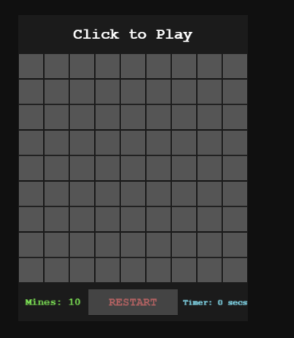
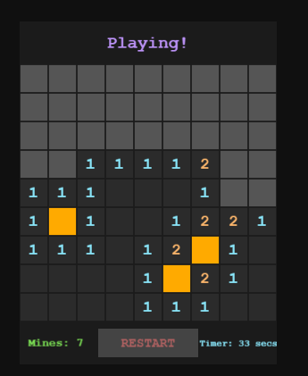
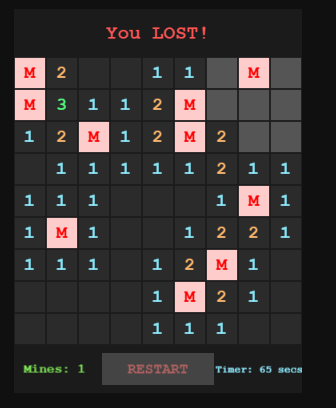
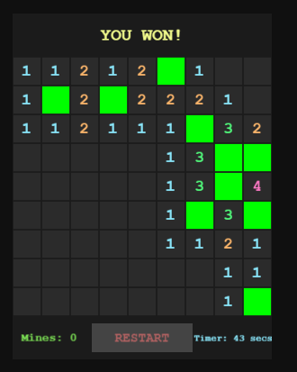

# Minesweeper-Via-Phaser


A simple Minesweeper clone built using **JavaScript** and the **Phaser.js** game framework.

This project was created as a beginner-friendly exercise to practice game logic, grid systems, and interactive UI handling.

**Play it here:** https://cosminelulul.github.io/Minesweeper-Via-Phaser/

---
# Features
- Title menu, difficulty select and a settings screen
- Four difficulties (grid size and mine count):
  - Easy: 9x9, 10 mines
  - Medium: 16x16, 40 mines
  - Hard: 30x16, 99 mines
  - ??? Beat all three to find out
- Score system with a step-down time multiplier (see below)
- Score popup that counts up when you win
- Randomly placed mines (first click and the cells around it are always safe)
- Recursive reveal for empty cells
- Flagging system (right-click, or hold on a touch screen)
- Flag and bomb icons
- Sound effects for clicking, winning and losing
- Settings: mute the sound, turn animations on or off
- Quick fades and button animations
- Win / lose detection
- Game restart button
- Live mine counter and timer
- Progress and settings saved in the browser (localStorage), no server or database needed
- Window scales down to fit smaller screens
- Clean UI with color-coded numbers
---
# Scoring
Every tile you reveal is worth **100 points x the current multiplier**.

The multiplier starts at **5.0x** and steps down by 0.8 as time passes, until it reaches the **1.0x** floor.
Bigger grids get longer grace periods, so a bigger board never punishes you for taking your time.

| Multiplier | 9x9 (Easy) | 16x16 (Medium) | 30x16 (Hard) |
|------------|------------|----------------|--------------|
| 5.0x       | 0 - 5 sec  | 0 - 15 sec     | 0 - 30 sec   |
| 4.2x       | 5 - 12 sec | 15 - 40 sec    | 30 - 80 sec  |
| 3.4x       | 12 - 22 sec | 40 - 75 sec   | 80 - 150 sec |
| 2.6x       | 22 - 35 sec | 75 - 120 sec  | 150 - 240 sec |
| 1.8x       | 35 - 50 sec | 120 - 180 sec | 240 - 360 sec |
| 1.0x       | 50+ sec    | 180+ sec       | 360+ sec     |
---
# Running the Project on your Machine
```
git clone https://github.com/cosminelulul/Minesweeper-Via-Phaser
Open index.html in your browser
```
Note: No build tools or dependencies required — runs directly in the browser.
(Phaser is loaded from a CDN, so you need an internet connection.)

---
# Project Structure
```
index.html   - the page
app.js       - shared constants, difficulties, saved data, game setup
menu.js      - loading, title menu, settings and difficulty select
game.js      - the Minesweeper game itself
assets/      - icons, sounds and screenshots
```
---
# Credits
- Sound effects made with [jsfxr](https://sfxr.me/)
- Flag and bomb icons designed by me
- GitHub logo from [Simple Icons](https://simpleicons.org/) (CC0)
---
# Screenshots!




